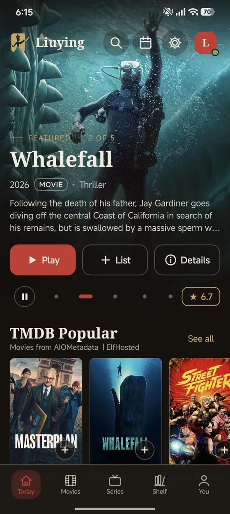
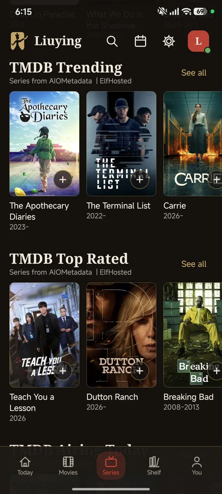
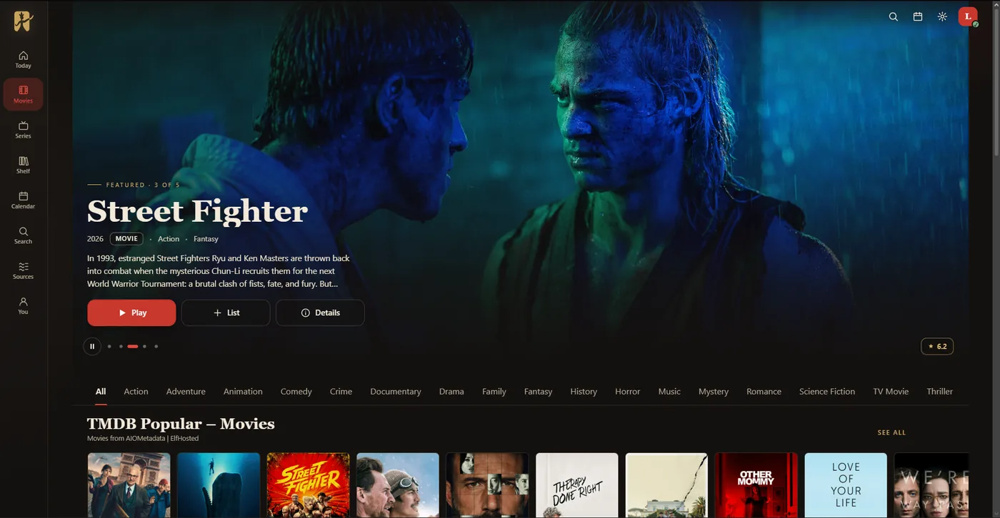
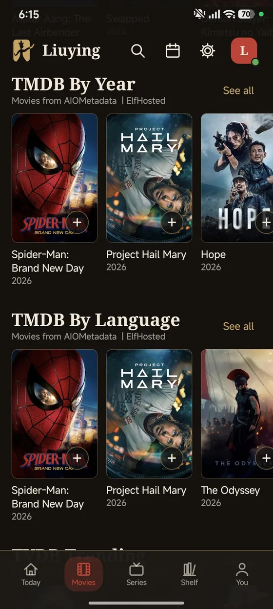
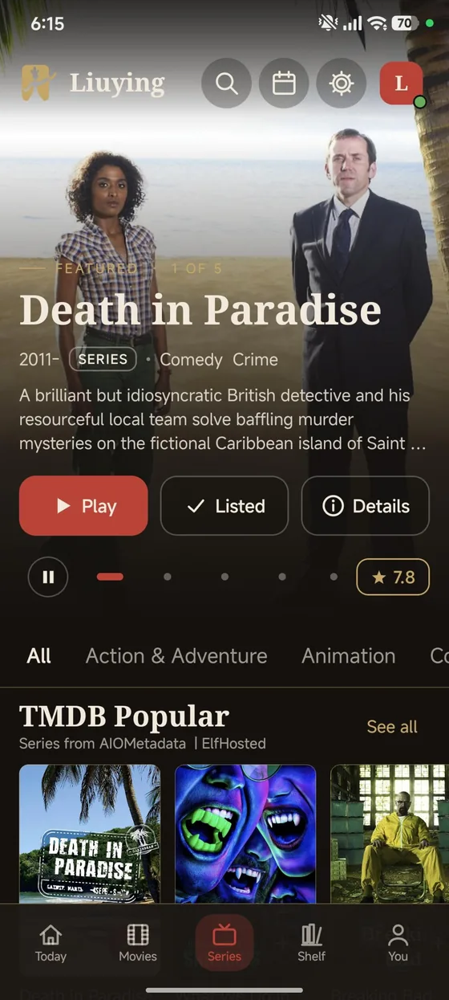
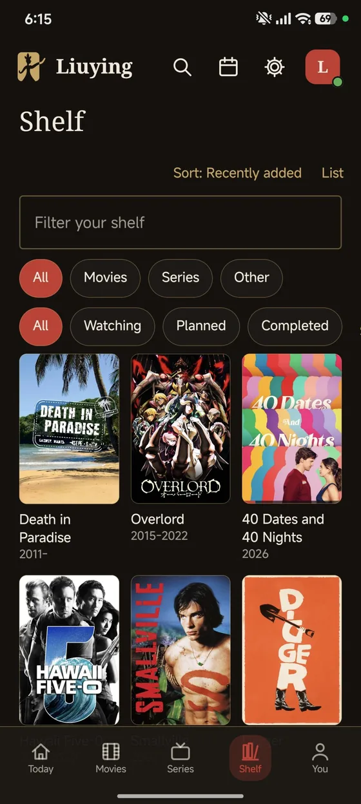

# 流影 Liuying

**A media centre for your own sources.** Android app (Kotlin + Compose), a browser player, and a
small account/sync backend. Liuying hosts nothing: you point it at sources you already have access to.

**[Use it](https://www.liuyingapp.com)** · **[Download the APK](https://www.liuyingapp.com/download)** ·
**[Open the web player](https://www.liuyingapp.com/watch)**

  

## What it is

- **Android-first.** Compose UI, Media3 playback, offline-first Room + DataStore storage, no account required.
- **A real player.** Audio and subtitle track selection, subtitle styling, gestures, PiP, sleep timer, resume.
- **Your sources.** Add addon/source URLs (the Stremio manifest format); catalogs, streams and subtitles are
  fetched from them and merged into one library view.
- **A web player too.** The same sources and progress in a browser, signed in or not.
- **Optional sync.** A username/password account syncs sources, shelf, progress and settings between the
  app and the web through a small API.
- **No ads, no analytics, no bundled content.**

## What it is not

- It does **not** host, bundle, or link to any media. Everything comes from sources the user adds.
- It does **not** circumvent DRM or paywalls.
- The plugin runner (JavaScript, off by default) executes **third-party code** the user chooses to install;
  those plugins are not reviewed or endorsed by this project.

## Screens

| Android | | | |
|---|---|---|---|
|  |  |  |  |
| Today | Movies | Series | Shelf |

| Web |
|---|
|  |

## Repository layout

| Path | What lives there |
|---|---|
| `app/` | The Android app — Kotlin, Compose, Room, Media3, QuickJS plugin runner |
| `site/` | The public website and the web player (`site/watch/`) — plain HTML/CSS/JS, no build step |
| `cloudflare/` | The current backend: one Worker serving the site, the web player and the sync API on D1 |
| `server/` | The previous Express + PostgreSQL backend, kept until the Cloudflare cutover is complete |
| `docs/` | Architecture, plugin contract, design reference, research, audits, release notes |
| `scripts/` | Release tooling |

## Build it yourself

### Prerequisites

| Tool | Version | Notes |
|---|---|---|
| JDK | 17 or newer | Gradle runs on it; Android plugin 8.10 |
| Android SDK | platform 36, build-tools 36 | `ANDROID_HOME` must point at it, or set `sdk.dir` in `local.properties` |
| Node.js | 20 or newer | For the Worker, the Express server, and the site tooling |

### Android app

```bash
# debug build, installable next to a release build
./gradlew :app:assembleDebug        # app/build/outputs/apk/debug/app-debug.apk

# release build (needs a keystore, see below)
./gradlew :app:assembleRelease

# Play Store bundle
./gradlew :app:bundlePlay           # app/build/outputs/bundle/play/app-play.aab

# tests
./gradlew :app:testDebugUnitTest    # 237 JVM/Robolectric tests
```

The `play` build type is the release build minus self-update: it drops the
`REQUEST_INSTALL_PACKAGES` permission and never checks for an APK update. The direct-download build
(`assembleRelease`) keeps the in-app updater.

**Signing.** Create `keystore.properties` in the repository root (it is git-ignored):

```properties
storeFile=/absolute/path/to/upload.jks
storePassword=…
keyAlias=…
keyPassword=…
```

or set `LIUYING_KEYSTORE`, `LIUYING_KEYSTORE_PASSWORD`, `LIUYING_KEY_ALIAS`, `LIUYING_KEY_PASSWORD`.
Without a keystore the release build falls back to the debug key — fine for testing, not for distribution.

Generate a key with:

```bash
keytool -genkeypair -v -keystore upload.jks -alias liuying -keyalg RSA -keysize 4096 -validity 10000
```

### Web player

`site/` is static. Serve it with any web server, for example:

```bash
npx serve site    # or: python -m http.server -d site 8000
```

`site/watch/` is the player SPA; it talks to the API under `/api`.

### Backend (Cloudflare Worker + D1)

```bash
cd cloudflare
npm ci
npm test            # 48 tests, no network needed
npm run dev         # local Worker with a local D1
npm run deploy      # needs CLOUDFLARE_API_TOKEN and a wrangler login
```

See [docs/cloudflare.md](docs/cloudflare.md) for the schema, the endpoints and the deploy runbook.

### Backend (legacy Express + PostgreSQL)

```bash
cd server
npm ci
npm test            # 63 tests
npm start           # http://localhost:3000, in-memory DB unless DATABASE_URL is set
```

## Configuration and secrets

Nothing sensitive is committed. The repository ignores `keystore.properties`, `*.jks`, `*.keystore`,
`.env`, `local.properties`, build output and `node_modules`.

| Secret | Where it goes |
|---|---|
| Android signing | `keystore.properties` or `LIUYING_*` environment variables |
| Cloudflare deploy | `CLOUDFLARE_API_TOKEN` environment variable |
| Server database | `DATABASE_URL` environment variable |

## Documentation

| Document | What it covers |
|---|---|
| [docs/README.md](docs/README.md) | Index of everything in `docs/` |
| [docs/plugins.md](docs/plugins.md) | The plugin contract, sandbox and relay |
| [docs/cloudflare.md](docs/cloudflare.md) | Worker, D1, deploys and migration |
| [docs/design-reference.md](docs/design-reference.md) | Colour, type, spacing and motion tokens |
| [docs/research-report.md](docs/research-report.md) | The user research behind the features |
| [docs/backlog-100.md](docs/backlog-100.md) | 137 itemised improvements with status |

## License

[MIT](LICENSE) © 2026 Liuying.

## Disclaimer

Liuying is a client. It does not provide, host, or endorse any content, and it is not affiliated with any
source, addon or plugin author. You are responsible for the sources you add and for complying with the law
where you live and with the terms of the services you use.
